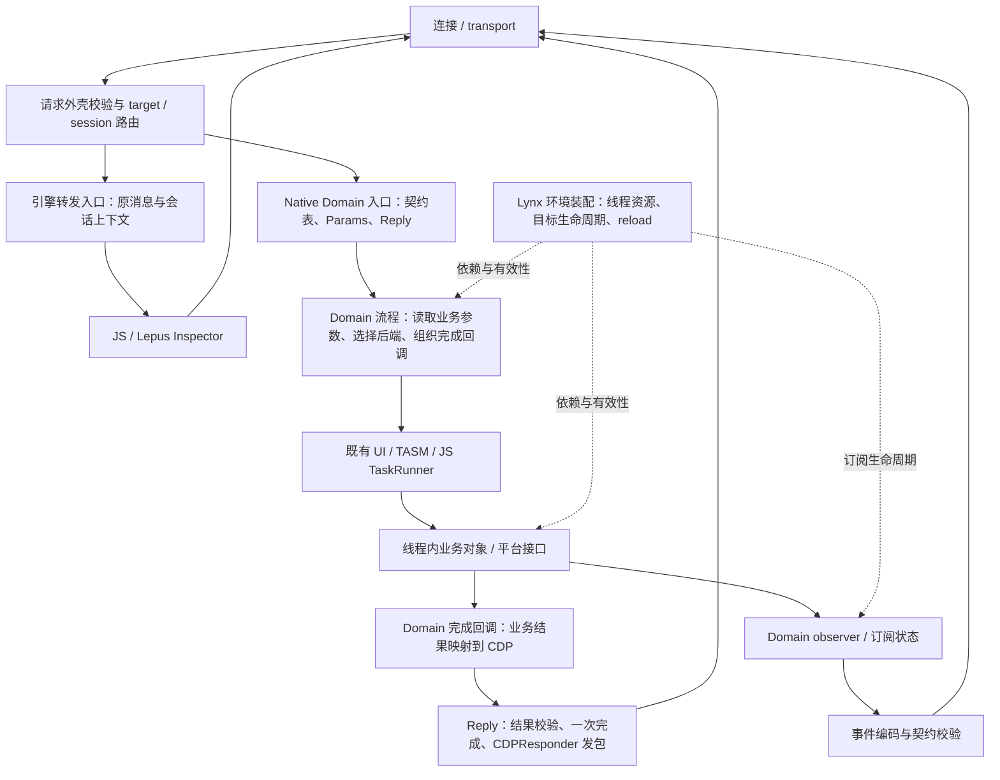

# CDPC 与 Lynx CDP 架构设计

更新：2026-10-21。状态：设计草案；本文的 C++ 接口、目录和独立工具接口均为目标设计，尚未实现。本轮只更新文档并初始化独立仓库，暂停中的 CDPC 代码改造继续保持暂停。

> A contract-first CDP toolkit for Lynx.

CDPC 负责让协议契约成为可校验、可生成、可比较的工程输入。Lynx 负责把一个请求执行完成：选择目标和后端、安排线程、处理业务状态、构造结果，以及管理事件订阅。新的 CDP 组织方式从这两个职责出发，覆盖 native 请求、异步完成、引擎转发和事件。

本设计重新安排整个 CDP 处理架构。底层平台能力、DOM/CSS 操作、手势控制器和现有线程设施继续复用；develop 用来核对行为兼容性。无需为了保留现有类关系，让 JSON 或回复句柄继续经过每一层。

## 设计结论

1. **CDPC 独立仓库同时提供契约工具链和小型 C++ 运行时。** Params、Reply、契约描述和方法表辅助放在 CDPC；具体契约、业务注册、发送适配、线程及构建集成留在 Lynx。
2. **Domain 是协议适配和业务流程的归属。** 在 Domain 入口校验参数，转换成明确的业务 C++ 值，再进入执行层；业务执行结束后，由 Domain 映射为 CDP 结果。
3. **线程资源与 Domain 组织分开。** Mediator 保留装配、线程资源和目标生命周期职责；逐方法转发不再作为新架构的必经层。
4. **采用可复制的 `cdpc::Reply`。** 副本共享一次完成状态，底层复用现有 `CDPResponder`，不修改这个类。保留已经确定的析构空成功加 warning 行为。
5. **不新增宏或 `cdpc::Error`。** 参数读取返回 `base::expected<T, CDPErrorCode>`，诊断文本通过调用方提供的 `std::string&` 返回。
6. **方法注册手写静态契约表。** 生成器提供契约描述，不生成 Domain 继承体系、业务实现或方法分发代码。
7. **类型约束有明确范围。** 契约检查协议数据，C++ 参数表达业务输入，Reply 控制正常回复尝试次数；它们不能替代目标有效性、线程约束或业务完成判断。

引用 Folly 等库的是表达错误、所有权和接口约束的方法。继续使用标准容器、智能指针及 Lynx 的 expected、closure、TaskRunner，不建设另一套 C++ Foundation Lib。

## 为什么需要重新组织整个 CDP

现有 Mediator 注释已经提出“Agent 解析 CDP 参数、Mediator 调度、Executor 执行”。实际接口中，多个 Domain 仍然传递完整 message 或 params JSON，在 Executor 或 delegate 才读取字段、调用业务并回复。协议知识和业务流程因此分散在多个文件里。

这不只发生在 Input：

| 请求 | 当前路径的代表性职责分布 | 新设计中的归属 |
|---|---|---|
| Input.insertText | Agent、Mediator、UIExecutor 转发；InputRequestHandler 读 text、调平台、回复 | Input Domain 读 string；UI 上的业务对象执行；Domain 的任务回调完成 Reply |
| DOM.getAttributes | Agent、Mediator 转发；TASMExecutor 读 nodeId、查节点、构造 CDP 结果 | DOM Domain 读节点 ID、编码结果；线程内 DOM 操作只处理节点和属性 |
| CSS.getComputedStyleForNode | Agent、Mediator 转发；TASMExecutor 读取并构造响应 | CSS Domain 持有协议映射；布局与样式读取留在正确线程 |
| Page.navigate | Agent、Mediator 转发；UIExecutor 读取 URL、调用平台及发送消息 | Page Domain 编排导航与事件时序；平台接收 URL 和业务选项 |
| GlobalProps.replace | Agent、Mediator 转发；TASMExecutor 提取 globalProps 并更新 | Domain 验证并交出明确的动态数据副本；业务层执行更新 |
| WhiteBoard.getSharedData | Mediator 选择 TASM 或 JS 路径；delegate 解析、执行并回复 | WhiteBoard Domain 编排后端选择；两条执行路径返回一致的业务结果 |
| Runtime / Profiler 等 | Agent 将消息交给 JS 引擎 | 显式的引擎转发路径，最终响应由引擎拥有 |
| 各 Domain 的事件 | 业务 observer、delegate、Mediator 等共同参与 | Domain 管理订阅和事件编码；共用 Lynx 的会话发送出口 |

问题不是类的数量本身，而是接口没有划清“谁知道 CDP 字段”“谁决定执行流程”“谁拥有状态”“谁完成请求”。把 `Json::Value` 换成 `Params` 后沿原链继续传递，仍然保留了这种职责分散。

## CDPC 独立仓库与 Lynx 的边界

独立仓库为 `git@code.byted.org:lynx/cdpc.git`，本地目录为 `~/code/cdpc`。首次初始化只包含说明文档，现有工具源码不在本轮搬迁。

| 内容 | CDPC 仓库 | Lynx 仓库 |
|---|---|---|
| 契约模型 | 字段、引用、union、约束、诊断和版本化数据格式 | 使用该模型描述 Lynx 支持的协议 |
| 协议来源 | 加载、合并、比较上游协议的机制 | custom_cdp_docs、偏差说明、选定的 upstream 快照及更新决策 |
| 校验 | 字段语义、示例与离线流量校验、共享测试用例 | 实际请求接入、业务约束、响应与事件的运行时接线 |
| 生成 | 与仓库布局无关的规则整理和描述数据生成 | Lynx C++ emitter、命名空间、include、导出符号、输出路径及 GN/CMake 集成 |
| 实现清单 | 接收规范化的实现清单并与契约比较 | 扫描 C++ 注册、PrimJS 来源、feature 开关和 Lynx 源码位置 |
| CLI | 显式输入、输出、配置、诊断及退出码 | tools/cdpc 包装、版本锁定、消费者专用命令 |
| 录制与测试 | 离线 trace 格式支持及验证机制 | 运行时 observer、recorder、ContractTestHarness、设备与前端验证 |
| 主动采样 | 可复用的示例检查机制 | agent-lynx 调用、设备目标选择、节点占位符解析和安全采样约束 |
| C++ 运行时 | Params、Reply、Method、契约描述及重复注册检查 | 请求外壳与 Dispatch 接线、CDPResponder 适配工厂、事件出口、线程投递 |
| 业务执行 | 不持有业务实现 | Domain、目标路由、生命周期、线程、平台能力和 JS 引擎接入 |

**Params 和 Reply 的实现放在 CDPC 仓库。** 首版保持本文的 `lynx::devtool::cdpc` 命名空间，避免在拆仓时同时修改所有名字。CDPC 面向 Lynx，可以显式复用 JsonCpp、`lynx::base::expected` 和现有 `CDPErrorCode`；独立仓库不要求重新实现这些类型。

构建时由消费者提供已有依赖的目标或路径，不复制一套 expected、错误枚举和 JSON 类型。CLI 核心应在没有 Lynx checkout 时运行；C++ runtime 单测单独构建，但首版仍需要声明的 Lynx 公共类型依赖。`expected.h` 还包含 expected_internal、FML macros 和 type_traits_addon，不能把它描述成随手搬一个头文件即可。第一轮构建要确认实际依赖范围及 JsonCpp 版本一致性，不编译 Explorer 或业务 Domain 来验证基础库。

Reply 核心接收两个 CDP 专用完成回调，不直接包含 CDPResponder、MessageSender、Mediator 或 TaskRunner。Lynx 的适配工厂把回调连接到现有 responder。普通 Domain 只接收建好的 Reply；不为多个假想宿主设计 transport、scheduler 或基础类型插件体系。

Lynx 的具体契约和业务实现应在同一个变更中更新。不能为了使用独立工具，把新增一个 Lynx 方法变成“先向 CDPC 仓库提交业务 YAML，再改 Lynx”的双仓协作。

### 工具链的数据流与版本

```text
Lynx 的本地契约 + 固定 upstream 快照 + 偏差声明
                         │
Lynx 注册扫描 ── 实现清单 ┼──→ 固定版本的 CDPC
                         │       ├── 契约/示例/清单诊断
                         │       ├── effective contract 与生成数据
                         │       └── 离线 trace 验证
                         │
                         └──→ Lynx emitter ──→ C++ 契约描述与规则
                                               │
                                     Lynx Domain / 测试 / 构建
```

CDPC 不能通过自身文件的 `parents[5]` 猜测 Lynx 根目录，也不能内置消费者输出路径。Lynx adapter 负责给出配置、规范化的实现清单和具体输出位置。先提供一个明确的 Lynx adapter 即可，不为假想消费者建设插件框架。

独立 CLI 的目标调用形态如下；这些是拟议命令，当前仓库尚未提供独立可执行程序：

```bash
cdpc check --config /path/to/consumer-config.yaml
cdpc write --config /path/to/consumer-config.yaml
cdpc verify --config /path/to/consumer-config.yaml /path/to/trace.jsonl
```

现有 Lynx 使用者继续从 `tools/cdpc` 进入，由包装层传入配置、扫描结果和 emitter。保留 contract/check/write/show/new/verify/upstream 的职责；capture 的设备动作在 Lynx adapter 中。拆分期间不同时改变所有命令的使用方式。

工具版本先以固定提交或正式发布版本锁定，不跟随 main 浮动。生成文件记录工具版本、契约输入标识和格式版本；消费者拒绝不支持的格式。工具升级与 Lynx 业务变化分别评审，升级时比较诊断、生成结果和行为测试。现有受版本控制的生成产物仍随 Lynx 契约更新，不要求普通构建临时联网获取工具。

## Lynx 内部的目标架构



图中的“Domain 流程”和“Domain 完成回调”是职责，不要求新建两个类。同步操作可以在同一函数完成；跨线程操作使用已有 closure。每个 Domain 根据真实状态决定是否需要手写的执行对象，生成器不为每个方法创建 Backend 虚接口。

### 请求入口与路由

入口校验 JSON 外壳，确定 method、有效 id、params 以及目标/会话上下文，再选择 native 或引擎路径。id 的相关性限定在连接和会话内，不能用全局整数 id 关联不同会话的请求。

native 方法在查表命中后创建一次 Reply，并使用该表项绑定的契约建立 Params。参数失败时立即回复，业务 handler 不执行。缺失或不支持的契约是集成错误，不能作为“无参数方法”放行。

引擎路径保留消息和会话信息，由引擎拥有最终响应。入口不得先为每条请求创建一个会析构补成功的 native Reply，再把消息转发给引擎。转发失败可以由转发入口返回明确错误；成功交接后不能另补 native 响应。引擎版本支持范围与 native 契约覆盖范围分别记录。

非法外壳和未知方法由入口的协议错误发送逻辑处理，无需伪造方法契约。它可以复用现有 CDPResponder 发送能力；普通 Domain handler 接触不到原始 sender。

### Domain 与执行层

Domain 持有方法注册、参数读取、业务流程、后端选择、CDP 结果编码和事件订阅逻辑。业务执行层接收 string、数值、已有 MouseEvent 或小型手写业务结构，返回业务结果或完成回调。

`Params` 停留在协议适配范围。需要多层调用的业务数据应在投递前读完；字段较多时用已有业务类型或手写参数结构。真正的动态 payload 可以保留为经过约束检查的 JSON 副本，但接口应明确该参数的含义，不能继续传完整 CDP message。

`Reply` 由 Domain 的请求任务或完成回调持有。平台接口不需要知道请求 id、CDP 错误码或 Reply。异步操作通过原有 callback 返回业务结果；Domain 回调再完成协议响应。

### Mediator、Executor 和生命周期

Mediator 当前承担初始化线程、创建执行对象、更新平台 facade、reload 后状态恢复、runtime 绑定及 Destroy 顺序等真实职责。这些职责需要保留并集中管理。新的组织方式逐步减少逐方法的 JSON 转发，让它成为运行环境的装配和生命周期协调者。

UI/TASM/JS 表达执行资源；Input/DOM/CSS/WhiteBoard 表达业务和协议归属。按线程汇总大量 Domain 方法的 Executor 可以拆出 Domain 的线程内操作对象，但执行线程约束和真实共享状态必须保留。例如 InputRequestHandler 的手势控制器与 Reset 行为不能因为 InsertText 只是转发就一并删除。

具体生命周期由 Lynx 管理：

- App-global、单 LynxView、session 三种作用域分别创建依赖和订阅，不能全部挂在一个全局 Domain 实例上。
- reload/Destroy 更新目标代次并按既有线程顺序关闭旧状态；跨线程任务在实际执行时检查目标及代次。shared_ptr 保活旧 executor 不表示它仍可处理新页面。
- 已知取消、目标销毁或后端失败，由 Domain 的完成路径显式回复错误；Reply 析构只是漏回复兜底。
- enable/disable 和断连负责安装、移除 observer。事件持有会话发送能力，不持有某个请求的 Reply。
- 发送出口保留 MessageSender 的线程与会话约束；Reply 的锁不赋予任意线程发送权限。

## 最终 C++ API 形态

以下均为拟议接口，省略导出标记和私有实现。Params、Reply、Method、HasUniqueNames 和接收完成回调的 MakeReply 属于 CDPC runtime；下面标注的 Dispatch 属于 Lynx adapter。`CDPRequest` 是 Lynx 入口校验外壳后建立的请求记录，拥有必要的输入数据，不进入 CDPC runtime 的公共依赖。

```cpp
namespace lynx::devtool::cdpc {

struct MethodContract;  // 静态生成：方法名、params 与 result 规则。
struct EventContract;   // 静态生成：事件名与 params 规则。

class Params {
 public:
  static base::expected<Params, CDPErrorCode> Parse(
      const Json::Value& raw, const MethodContract& contract,
      std::string& error_message);

  template <typename T>
  base::expected<T, CDPErrorCode> Get(
      std::string_view key, std::string& error_message) const;

  template <typename T>
  base::expected<std::optional<T>, CDPErrorCode> GetOptional(
      std::string_view key, std::string& error_message) const;

  template <typename T>
  base::expected<T, CDPErrorCode> GetOr(
      std::string_view key, T default_value,
      std::string& error_message) const;

  Json::Value CopyJson() const;
};

class Reply {
 public:
  // 可复制、可移动；所有副本共享一次完成状态。
  void SendSuccess(
      Json::Value result = Json::Value(Json::objectValue)) const;
  void SendError(
      CDPErrorCode code, const std::string& message = "") const;

  const Reply* operator->() const;  // 返回受控门面。
};

Reply MakeReply(
    int64_t id, const MethodContract& contract,
    std::function<void(Json::Value)> send_success,
    std::function<void(CDPErrorCode, const std::string&)> send_error);

template <typename Domain>
struct Method {
  const MethodContract& contract;
  void (Domain::*handler)(Reply, Params);
};

template <typename Domain, size_t N>
constexpr bool HasUniqueNames(const Method<Domain> (&methods)[N]);

// 以下声明由 Lynx adapter 提供，不属于 CDPC runtime 头文件。
template <typename Domain, size_t N>
void Dispatch(Domain& domain, const Method<Domain> (&methods)[N],
              const CDPRequest& request,
              const std::shared_ptr<MessageSender>& sender);

}  // namespace lynx::devtool::cdpc
```

Params 和 Reply 没有可构造的有效默认实例，只有入口工厂或已有实例的复制/移动。契约引用来自静态生成数据。Method 的函数指针约束 handler 形状；注册时还要验证该契约受支持并且名称无重复。

`cdpc::MakeReply` 是 CDPC 的完成回调接线入口，绑定 id 和契约。Lynx 另提供接收 sender 的 MakeReply 工厂，在 native 请求边界调用它；普通业务只接收 Dispatch 创建的句柄。两个完成回调必须有效，且只负责发送，结果校验、一次完成和重复诊断仍在 CDPC。此前的 MakeResponder 名称统一为 Reply/MakeReply。

### 实际例子：Input.insertText

develop 的调用链为：

```text
DevToolMessageDispatcher
  → InspectorInputAgent
  → LynxDevToolMediator
  → UI 线程上的 InspectorUIExecutor
  → InputRequestHandler
  → DevToolPlatformFacade::InsertText
```

目标的协议处理集中在 Input Domain：

```cpp
void InputDomain::Handle(const CDPRequest& request,
                         const std::shared_ptr<MessageSender>& sender) {
  static constexpr cdpc::Method<InputDomain> kMethods[] = {
      {cdpc::methods::kInputInsertText, &InputDomain::InsertText},
  };
  static_assert(cdpc::HasUniqueNames(kMethods), "Duplicate CDP method");
  cdpc::Dispatch(*this, kMethods, request, sender);
}

void InputDomain::InsertText(cdpc::Reply reply, cdpc::Params params) {
  std::string message;
  auto text = params.Get<std::string>("text", message);
  if (!text.has_value()) {
    reply->SendError(text.error(), message);
    return;
  }

  cdpc::PostRequest(
      ui_runner_, reply,
      [weak_input = input_, generation = generation_,
       text = std::move(text.value())](cdpc::Reply reply) {
        auto input = weak_input.lock();
        if (!input || !input->IsCurrentTarget(generation)) {
          reply->SendError(CDPErrorCode::ServerError,
                           "Input target is unavailable");
          return;
        }

        auto result = input->InsertText(text);
        if (!result.has_value()) {
          reply->SendError(CDPErrorCode::ServerError, result.error());
          return;
        }
        reply->SendSuccess();
      },
      /*run_now=*/true);
}
```

例子中的业务执行对象接收 `const std::string&`，返回 `base::expected<void, std::string>`；不接收 Params 或 Reply。`IsCurrentTarget` 示意在 UI 线程检查目标代次的 Lynx 能力，具体实现复用生命周期管理，不是已有同名接口。复杂错误继续使用业务自身的结果类型，由 Domain 映射，不能让所有业务为了 CDP 改成同一种错误模型。

当前 `DevToolPlatformFacade::InsertText` 返回 void，Android delegate 失效还可能直接 return。仅在 Domain 写 `SendSuccess()` 不能证明文本已插入。实现新接口时必须补足真实的执行状态，或明确方法只承诺“有效目标已接受请求”；不能由 adapter 无条件构造成功。这是需要改动平台能力契约的地方。

迁移后的数据关系是：

```text
JSON text → Params.Get<string> → 拥有内容的 string → UI 业务操作
                                                   │
                     Reply ← Domain 回调 ← 业务执行结果
```

多次回调或多个分支可以各持有 Reply 副本，但每个分支仍需有明确的业务含义。包装会识别第二次回复，不会阻止第二次插入文本等业务副作用。

### 编译期与运行时各约束什么

| 机制 | 能约束 | 不能证明 |
|---|---|---|
| Method 成员函数指针 | handler 接收 Reply、Params | 同签名函数是否绑对方法 |
| 静态契约表与重复检查 | 方法名、规则和处理函数放在同一表项；不静默覆盖 | 业务实现符合协议行为 |
| Params::Parse | 声明的字段、类型、必填、enum、引用与集合元素 | 本机 int32 可容纳所有 protocol integer；目标节点存在 |
| `Get<T>` | 读取类型、数值范围、缺失/null 语义 | 调用方一定检查 expected |
| 业务 string/结构 | 后续接口不再依赖 JSON 字段查找 | 字符串内容的业务合法性、线程正确性 |
| Reply | 同一共享状态最多一次正常发送尝试 | 一定收到响应、业务已成功、重复副作用已被阻止 |
| 结果/事件规则 | 发送的数据结构符合方法或事件契约 | 结果值真实、时序正确、前端行为正确 |

当前 `base::expected` 没有布尔转换，示例显式使用 `has_value()`。错误分支上调用 `value()` 仍可能终止程序，受检查的读取不等于任意解包都安全。

## Params 的读取语义

### 契约校验与业务读取

`Params::Parse` 检查整个方法输入，包括必填、类型、enum、引用、数组元素和动态 map 的值。Dispatch 只 Parse 一次，handler 再读取业务类型；不在 Mediator、Executor 和 delegate 重复查询同名契约。

顶层 params 缺失或为 null，沿用现有约定归一为 `{}`，之后仍需检查必填字段。嵌套 null 不归一。未知请求字段允许存在，但固定字段读取必须使用契约声明的名称。

某些既有契约登记了非 object 根等偏差，需要作为显式兼容路径保留。不能因此放宽普通请求外壳，或假定所有登记的偏差都能经过相同的 native 入口。

### 缺失、null、默认值与错误

| 读取方法 | 字段缺失 | 显式 null | 类型或值不匹配 |
|---|---|---|---|
| `Get<T>` | 必填缺失已被 Parse 拒绝；直接读取缺失的可选字段是 InternalError | T 必须显式覆盖 null 分支 | 返回错误 |
| `GetOptional<T>` | 成功返回 nullopt | 作为存在的值检查，不折叠成缺失 | 返回错误 |
| `GetOr<T>` | 使用显式默认值 | 不使用默认值掩盖 null | 返回错误，不回退默认值 |

先检查字段名、schema 和目标类型，再处理缺失。因此固定对象上拼错字段名的 GetOptional 也返回 InternalError。GetOr 的默认值必须符合契约和目标类型，无论请求中是否存在该字段；错误的 enum 默认值不能因为本次没用到就被忽略。

optional string|null 的读取结果为：

```cpp
base::expected<
    std::optional<std::variant<std::nullptr_t, std::string>>,
    CDPErrorCode>
```

外层 expected 表达错误，optional 表达缺失，variant 表达 null 或字符串。GetOptional 的 T 需要覆盖全部非缺失分支；直接 `Get<string>` 读取声明为 `string|null` 的固定字段属于内部使用错误，不能只因本次传入 string 就接受不完整的类型选择。

支持 bool、string、整数、float/double、Params、Json::Value，以及 std::variant、std::vector 的相关组合。optional 由 GetOptional 表达字段缺失，不提供 `Get<optional<T>>` 的 null 隐式转换，也不提供任意业务 struct 的反射编解码。

错误分类和文本输出固定为：

| 情况 | 返回码 |
|---|---|
| 请求不符合 schema，或值超出业务选择的整数/浮点范围 | InvalidParams |
| 固定字段拼写错误、schema 与读取类型不相容、缺少 union 分支、默认值非法 | InternalError |
| 缺少/不支持契约、描述数据不完整 | InternalError，并产生集成诊断 |
| 动态 any/object 的实际内容不满足本次业务读取要求 | InvalidParams；实现还需说明这项业务内容约束 |
| 目标不存在、操作失败 | 由 Domain 根据业务结果映射，不由 Params 推断 |

每次 Parse/Get/GetOptional/GetOr 成功都清空传入的诊断字符串，失败时覆盖为包含方法与字段路径的完整文本。错误码通过 expected 返回，文本由本次调用的调用方保存；Params 不维护共享可变的 LastError。并发调用应各用自己的诊断变量。

保留普通 C++ 控制流：

```cpp
std::string message;
auto modifiers = params.GetOr<int32_t>("modifiers", 0, message);
if (!modifiers.has_value()) {
  reply->SendError(modifiers.error(), message);
  return;
}
const int32_t flags = modifiers.value();
```

不引入 CDPC_ASSIGN_OR_REPLY、CDPC_RETURN_IF_ERROR、cdpc::Error 或新的 Result 别名。读取失败不修改业务目标变量；所有读取应在业务副作用前完成，错误传播不会回滚先前执行的操作。

### 数值转换

| 转换 | 语义 |
|---|---|
| JSON integer → C++ 整数 | 保留源整数的符号和宽度检查目标范围，不先转 double；负数不能读成无符号数 |
| JSON number → C++ 整数 | 必须有限、没有小数部分且在目标范围内；1.0 可读成 1，1.5 不隐式截断 |
| JSON 数值 → float/double | 拒绝非有限值和溢出；允许浮点舍入及下溢到零，不承诺十进制精确表示 |
| string / bool / null → 数值 | 不做隐式转换 |

realValue 转 int64/uint64 必须在转换前检查边界，不能把 double 中的 2^63 当作 INT64_MAX，也不能接纳 2^64。需要精确保持的 ID 使用整数读取；JSON 文本解析阶段已经丢失的精度无法恢复。

Parse 通过不代表所有 C++ 读取都能成功。protocol integer 的合法值可能超出 int32；number 也不保证可以放入 float。业务实际支持的范围需要说明。

与 develop 的两个差异必须单独验证：ReadIntParam 只接纳整数存储，目标 API 接纳可表示的 1.0；Input.dispatchMouseEvent 的坐标契约允许 number，而旧实现有 asInt 读取。若保留截断行为，应先 `Get<double>`，再显式检查范围并截断，不能机械替换成拒绝小数的 `Get<int32_t>`。

### 嵌套数据和生命周期

Params 持有不可变的拥有型 JSON 快照，副本共享只读存储。嵌套对象读取为 Params，数组读取为标准 vector；子 Params 同时保留存储、子 schema 和错误路径，父对象及原 message 销毁后仍有效。

```cpp
std::string message;
auto clip = params.Get<cdpc::Params>("clip", message);
if (!clip.has_value()) {
  reply->SendError(clip.error(), message);
  return;
}
auto width = clip.value().Get<double>("width", message);
if (!width.has_value()) {
  reply->SendError(width.error(), message);
  return;
}
```

这里展示嵌套读取语义，实际字段必须由所绑定方法的契约声明。Domain 读完必要的业务值后再投递任务，不因 Params 可以跨线程存活而继续把它传给所有后端。

| 契约对象形态 | 读取约束 |
|---|---|
| 固定 properties | 读取声明的属性；请求允许额外字段不等于业务可任意拼字段名 |
| 动态 values | 动态键按 values 契约读取；缺失业务键用 GetOptional 判断 |
| 裸 object / any | 只保证契约声明的部分；读取动态内容时检查实际类型，无法检查业务键拼写 |
| 显式 JSON 交接 | `Get<Json::Value>` / CopyJson 返回独立副本；后续原始 asXxx 操作不在安全读取保证内 |

生成数据必须保留“空固定对象”和“裸 object”的差别，不能用属性数为零猜测。字符串读取返回拥有内容的 std::string；不暴露借用 JSON 内存的 string_view 或可变引用。只读访问、快照与数组子视图的成本需在实现时测量。

## Reply 的共享、接管和完成

`Reply` 表示一次请求的回复能力，命名替代旧草案的 Responder / ResponderHandle。旧 CDPResponder 仍负责现有响应外壳和发包，包装增加共享完成状态与诊断。

```cpp
auto reply = MakeReply(sender, id, cdpc::methods::kInputInsertText);
// 上面是 Lynx 适配工厂，返回 CDPC 库中的 cdpc::Reply。
auto another = reply;

reply->SendSuccess();
another->SendError(CDPErrorCode::ServerError, "Backend failed");
// 第二次完成被识别为重复回复，不再发送。
```

普通 `std::shared_ptr<CDPResponder>` 已经共享同一个对象和生命周期。新包装的价值是拦截回复、同步完成竞争、绑定方法契约并记录重复完成；不实现 `cdpc::shared_ptr<T>`。

### 私有状态与发送顺序

```text
Reply A ─┐
Reply B ─┼── shared State（CDPC）── 成功/错误完成回调
任务回调 ─┘          │                       │
                    │                       └── 私有持有同一个 CDPResponder（Lynx）
                    └── 完成状态、锁、契约与请求诊断信息
```

operator-> 返回 Reply 自身的受控门面。State 持有完成回调，不直接持有或包含 CDPResponder 类型。Lynx 工厂私有创建旧 responder，两个回调各捕获同一个 shared_ptr；这个 shared_ptr 不交给业务，也不允许另一套回调独立回复同一请求。

Lynx 适配工厂的目标形态如下，代码尚未实现：

```cpp
cdpc::Reply MakeReply(const std::shared_ptr<MessageSender>& sender,
                     int64_t id, const cdpc::MethodContract& contract) {
  auto responder = std::make_shared<CDPResponder>(sender, id);
  return cdpc::MakeReply(
      id, contract,
      [responder](Json::Value result) {
        responder->SendSuccess(std::move(result));
      },
      [responder](CDPErrorCode code, const std::string& message) {
        responder->SendError(code, message);
      });
}
```

工厂返回后，底层 responder 只由这组受控完成回调持有。业务拿到 Reply，不能 get、RetrieveSender、转回原始 responder 或重新打开请求。测试可以接入记录响应的回调，无需构建 Lynx Domain 和平台后端。

显式发送按以下顺序执行：

1. 锁住 State；若已经完成，只记录重复完成诊断并返回。
2. 取得本次完成权，标记已完成，把成功和错误回调整组移到当前调用的局部变量，清空 State 的发送能力。
3. 释放锁；成功结果按绑定契约校验，合法则调用成功回调，非法则记录诊断并调用错误回调发送 InternalError。
4. 释放局部的两个回调及其捕获对象。成功发送后底层 sender 已清空，不再析构兜底。

必须整组取走并释放回调，不能只移动本次选中的一个，令另一个长时间保留底层 responder。外部发送不在锁内执行，重入也无法取得第二次完成权。回调只接一次完成结果，不在其中重新实现共享状态或契约校验。

以下析构行为描述 Lynx adapter 的接线；CDPC 核心不自行构造底层响应外壳：

| 情况 | 行为 |
|---|---|
| 复制 Reply | 增加共享持有者，不增加回复机会 |
| 不同副本并发发送成功/错误 | 一个分支取得完成权，其他分支记录重复诊断 |
| 显式发送后仍有副本 | 保留完成状态；发送回调和底层 responder 已释放 |
| 最后一个未完成副本释放 | 释放两个回调，底层 CDPResponder 最后一个持有者销毁，沿用 warning/dropped 与空成功兜底 |
| 一个任务销毁，其他副本仍存在 | 只减少一个持有者，不提前兜底 |
| 循环引用、长期缓存、任务未释放 | 仍可能 unanswered；不承诺超时或取消 |
| 对移动后的空句柄发送 | 记录误用，不解引用空状态 |

这里的一次完成指最多一次正常发送尝试，不是可靠传输确认。复制/移动赋值释放旧句柄，也可能触发旧请求最后持有者的析构。允许不同副本并发完成，不代表可以对同一个 Reply 变量并发赋值或移动而不加同步。

### 不改 CDPResponder 的边界

本方案不修改 CDPResponder 的类定义、发送实现和已经确定的析构策略。当前暂停中的代码已保留“warning 后空成功”；Lynx 适配层继续沿用，不能在 CDPC State 和旧对象里重复记录两次 dropped。CDPC 核心不硬编码所有宿主都必须析构发成功，兜底由被释放的完成回调及其私有发送对象决定。

析构补出的 `{}` 没有经过正常 SendSuccess 的 result 校验，也不证明业务成功；对于要求必填返回字段的方法还可能不符合返回契约。它是保留的兼容兜底，验收时应要求普通 native 路径显式完成，并把 unexpected dropped/unanswered 当作问题。若将包装移植回原始 develop，可在 State 的 pending 析构路径补 warning，仍无需修改旧类。

SendSuccess / SendError 返回 void，只表示调用完成，不表示前端收到响应。包装也不判断成功和失败哪个业务分支“应该赢”；Domain 必须组织正确的流程。

### 新架构与过渡接管

稳态路径在 native 请求边界直接 MakeReply；从创建开始就只有一个 State。它不需要先创建公共旧 responder，再进行一次“接管”。

逐 Domain 迁移时，旧 CallMethod 入口可以使用受限的同步 adapter：

```text
旧入口刚创建的 CDPResponder
    → RetrieveSender()
    → 旧对象失去 sender，不再析构补响应
    → 同一已校验 id 和方法契约创建 Reply
    → 后续只传 Reply，执行层接收业务值
```

adapter 只允许在旧对象尚未被异步发布、尚无并发调用且尚未回复的入口使用。message/id 必须与原请求一致；取不到 sender 时报告误用。RetrieveSender 本身不提供同步，不能包装一个已被任意复制和使用的旧 shared_ptr 后宣称所有别名都受保护。

新 Dispatcher/Domain 入口可以随架构重新设计；“不改 CDPResponder”不等于必须永久保留旧 Dispatcher 和 DomainAgentBase 的所有接口。桥接只用于过渡，不能成为新架构的中心。

## 调度、异步完成与事件

### CDP 请求投递

PostRequest 是 Lynx 侧的薄适配，内部使用既有 TaskRunner 和 base::closure：

```cpp
template <typename F>
void PostRequest(const fml::RefPtr<fml::TaskRunner>& runner,
                 cdpc::Reply reply, F&& task, bool run_now);
```

它只负责 runner 缺失时回复明确错误，以及让被投递的任务持有 Reply。task 接收 Reply；Domain 捕获已解析的业务值和可验证的目标引用。run_now 保持显式，避免把原本可立即执行的操作悄悄变成异步，或反向引入重入。

目标不存在、代次过期和业务失败由目标线程上的代码检查。TaskRunner::PostTask 返回 void，调用返回不证明任务已执行。闭包被销毁不自动等同业务取消；最后一个未完成 Reply 被释放时仍按兼容策略兜底。已知取消应在关闭任务链时显式完成。

Reply 可复制，可以继续用于既有 std::function；不因引入它而整体迁移回调类型。真正异步的手势等操作在最终业务回调里回复，不能投递成功就发送成功。

### 结果与事件的契约出口

目标设计让新 native 方法的显式成功响应、以及新 native 事件都经过绑定契约的出口。Result/event 采用严格字段规则；params 继续允许未知字段。返回体暂时仍是 Json::Value，运行时校验提供结构检查，不宣称已经有编译期的逐方法返回类型。

Reply 的正常 SendSuccess 负责 result 校验。事件使用 Lynx 持有的会话出口，示意接口为：

```cpp
class CDPEventSink {
 public:
  base::expected<void, CDPErrorCode> Emit(
      const cdpc::EventContract& contract, Json::Value params,
      std::string& error_message) const;
};
```

Emit 校验失败返回 InternalError、记录事件和字段路径，不发送非法事件，也不伪造请求错误响应。成功仅表示已通过校验并交给发送通道；既有 SendMessage 没有前端接收确认。断连和会话失效由 Lynx 出口与订阅管理处理。

Domain 负责订阅状态、事件时机和 payload，出口接回现有 SendCDPEventImpl 的 transport 与 SDK listener 路径，保留原有过滤及顺序。不能通过直接发送 sender 绕过这些能力，也不能拿 Reply 当长期事件发送器。

**这是目标能力，当前没有这样的完整生产实现。** 当前完整 contract checker、嵌入 JSON 和 ContractTestHarness 都是 testonly；生产已有的主要是参数规则。实现时应生成小型 result/event 描述并复用字段校验语义，评估体积和开销，不能把完整 testonly checker 直接链接到生产。与 Python checker 的共享语义用同一组案例验证。

旧引擎输出、明确登记的兼容路径和析构 fallback 单独观测；不能因为新 native 出口有校验就宣称所有流量均受保证。开启严格出口前，先记录对 develop 既有 payload 的差异，避免把兼容变化藏进基础设施接入。

## 方法表与特殊路由

普通 native 方法使用“契约描述＋成员函数”的静态数组。Dispatch 的顺序为查找方法、取得同一表项的契约、创建 Reply、Parse、调用 handler。坏参数不会进入 handler；未知方法返回 MethodNotFound；已注册但缺少可用契约不能被当作空参数方法。

方法名称只来自契约，避免注册字符串和校验字符串分离。HasUniqueNames 做编译期重复检查，生成描述需支持静态初始化。源码扫描也应检测符号命名碰撞。首版线性查找即可；现有表最大 30 条，是否优于 map 需要测量，不能仅凭减少实例分配宣称整体性能提升。

对本地 develop、当前已提交 HEAD 和工作区复查，均有 26 个 Domain Agent 文件、147 条 `functions_map_["..."] =` 注册，单表 1～30 条。现有注册集中在构造函数，未发现运行时增删用途。多数使用 std::map，Debugger 和 Network 使用 unordered_map。这个统计支持去掉实例级可变表，但不代表 147 条都是普通 native 请求。

| 路径 | 现有特殊语义 | 目标处理 |
|---|---|---|
| Debugger.enable | 本地 hook 后仍转发引擎，hook 不负责响应 | 显式 hook + 引擎转发；不为 hook 创建 native Reply |
| Runtime / Profiler / HeapProfiler | 直接转发引擎，没有上述 native 成员表 | 保留明确的引擎入口，不强制套 native Dispatch |
| Log 的 sessionId 判断 | 带 sessionId 的消息返回 MethodNotFound，避免 MTS target 重复事件 | 在路由中保留过滤；不能被通用表覆盖 |
| Recording / Replay | feature 关闭时返回未实现 | Domain/路由显式检查能力，保留相关错误语义 |
| Component.uselessUpdate | 将参数作为同名事件发出，没有普通 result | 登记为兼容路径；不因换表自动新增成功响应 |
| HSR | 已有专用 HSRScriptRequest 解析和显式分支 | 保留必要的业务协议解析，不强制当作普通字段搬运 |
| WhiteBoard | 按可用运行环境选择 TASM 或 JS 后端 | Domain 编排后端选择，环境提供可用能力；只由选中的流程完成请求 |
| Lynx.transferData | 暂停中的分支相对 develop 新增响应 | 作为独立行为差异记录；按当前要求暂不把前端 owner 确认列为本轮阻塞 |

兼容路径是可追踪的例外，不应在通用 Dispatch 中增加任意 predicate、原始 sender 逃逸或自动回复猜测。它们可以保持少量显式分支。新能力默认按契约设计；既有不规范行为是否调整，要作为独立协议变化决定。

### 注册扫描必须同时演进

现有 inventory.py 依赖旧目录、functions_map_ 字符串和部分 CallMethod 内的 if 语法。新目录和静态契约符号会使旧扫描漏报，不能只改 C++ 注册表。

Lynx adapter 需要解析约定的静态表语法，把契约符号、协议名、handler 和源码位置交给 CDPC。符号映射来自源契约与共享命名规则，不依赖上一次生成文件，也不能把“生成过某方法”当作“实现已注册”的证据。

过渡期支持旧表、新表和显式转发规则；遇到无法识别的注册形态要诊断，不能静默当作删除。迁移目录时同步更新扫描范围。参数读取检查仍追踪原始 JSON 逃逸，不能因为函数调用 Dispatch 就豁免整条业务链。

## 代码组织与改动面积

以下为建议的目标目录，尚未创建：

```text
CDPC 仓库
  include/cdpc/    Params、Reply、契约描述、Method 与重复检查
  src/            参数读取、共享完成状态、结果校验
  tests/          runtime 单测与示例；显式提供首版公共类型依赖
  工具核心         契约模型、校验、诊断、上游比较、规则生成、离线验证
  CLI 与工具测试   不依赖 Lynx checkout

Lynx 仓库
  devtool/lynx_devtool/protocol/
    custom_cdp_docs/、cdp_upstream/、cdp_support.yaml
    生成的契约产物
    Lynx adapter：源码扫描、C++ emitter、采样和版本集成
  devtool/lynx_devtool/cdp/
    adapter/       MakeReply、Dispatch 接线、请求投递与事件出口
    routing/       native / engine / session 路由
    domains/       按 Input、DOM、CSS、WhiteBoard 等组织协议与业务流程
    environment/   目标依赖、线程资源、生命周期与订阅装配
  devtool/base_devtool/native/
    现有 MessageSender、CDPResponder 及通用消息入口能力
```

Domain 内需要的线程操作可以与 Domain 放在一起，不强制每个目录具有相同数量的类。大型 Executor 中确实共享的布局/渲染状态保留明确的线程内拥有者；重组不能把跨 Domain 的共享状态复制成多份。

| 改动面 | develop / 当前工具的形态 | 目标工作 |
|---|---|---|
| 协议入口与路由 | 通用 Dispatcher、Agent 注册和各自的引擎转发 | 明确 native/engine 所有权与 session；新 native 边界直接创建 Reply |
| Domain 注册 | 26 个 map、147 条构造赋值及重复查找 | 普通方法静态契约表；特殊分支显式保留 |
| 参数与业务接口 | 多层 Json::Value、局部 helper、晚期 asXxx | Domain 完成读取，线程内接口接收业务值；移除重复协议解析 |
| Mediator / Executor | 装配、状态、调度和逐方法转发混合 | 保留生命周期与资源管理；将协议流程按 Domain 收拢 |
| 平台执行结果 | 部分 void 返回或失效后静默返回 | 对需要报告成败的能力补足真实状态，Domain 再映射协议响应 |
| 回复 | `shared_ptr<CDPResponder>`、sender 和手工外壳并存 | 新 native 请求统一 Reply；事件与引擎保留独立出口 |
| 事件 | payload、订阅与发送分布在多处 | Domain 管理订阅/编码；契约出口接回原有发送链 |
| 参数规则 | 当前已有生成与部分 CheckCDPParams 接入 | 复用规则语义，增加安全读取及完整 descriptor，不维护两套字段规则 |
| 结果/事件规则 | 完整 checker/harness 目前 testonly | 新增适合生产的描述数据与出口检查，保留 testonly 验证工具 |
| CDPC 核心拆分 | Repo.current 固定根目录；emit 写固定路径 | 显式消费者输入/输出；通用部分独立，路径和构建留在 Lynx |
| 源码扫描 | inventory 认识 Lynx Agent、PrimJS 和旧表语法 | 扫描归 Lynx adapter，兼容新目录与新表，输出规范化清单 |
| 工具启动 | tools/cdpc 依赖 env.sh、PYTHONPATH 和仓库内模块 | 保留消费者入口，锁定独立工具版本并完成适配 |
| CDPResponder | 当前已选定 warning + 空成功 fallback | 本方案不改类实现；通过私有包装使用它 |

主要工作量在业务边界、完成路径和状态归属，不能用一次替换 Params/Reply 签名完成。147 条是注册项数量，不是工期或唯一请求路径的估算；同一请求可能涉及多个线程和异步分支。

## 隐患与 develop 对比

| 隐患 | develop 的约束 | 目标处理 | 仍需业务保证 |
|---|---|---|---|
| 非法 JSON 转换 abort | 局部 helper 与直接 asXxx 并存 | 入口契约检查和受检查读取 | 不绕过 getter，不错误解包 expected |
| 缺失/null/default 混淆 | 部分依赖 JsonCpp 缺省转换 | optional、variant、GetOr 各有明确语义 | 默认值和兼容差异经过确认 |
| 整数边界和小数 | 取决于调用点 | 保留整数精度、检查本机范围，显式截断 | 说明具体方法的支持范围 |
| 协议字段传播过深 | 多层转发 JSON，底层解析 | Domain 转换成业务值 | 动态 JSON 交接后的使用仍受审查 |
| 重复回复与重入 | 原 responder 发送后 reset，未同步完成竞争 | Reply 先取得完成权，再在锁外发送 | 所有普通回复经过同一个 State |
| 漏回复被空成功掩盖 | 最后一个旧 responder 析构补成功 | 保留兼容兜底，明确 warning/dropped/unanswered | 正常路径显式完成，不以 fallback 证明正确 |
| 排队任务或目标失效 | 多层按调用点检查；保活不等于有效 | 目标线程检查生命周期与代次；已知取消显式失败 | 不把投递成功当执行成功 |
| 平台静默失败 | 部分 void/空实现无法报告状态 | 补足需要的业务结果接口 | 明确“接受”与“执行完成”的语义 |
| 错误后端或双响应 | native、hook、engine 路径交错 | 路由决定单一完成所有者 | WhiteBoard 等流程正确选择后端 |
| 事件泄漏、错 session | observer 与发送能力分散 | Domain 管理订阅，出口绑定会话/目标 | enable、disable、断连、reload 时序 |
| 结果/事件结构错误 | 原 sender/responder 不证明契约 | 新 native 出口严格校验 | fallback、引擎与兼容例外单独记录 |
| 静态表绑定错误 | 字符串分散，同名 map 赋值覆盖 | 同一描述绑定 handler，重复检查 | 同签名错绑依赖行为测试 |
| 独立工具与消费者漂移 | 同仓工具默认与源码同步 | 版本锁定、格式检查、集成案例与生成差异 | 业务契约仍与实现同仓更新 |
| 双系统过渡 | 现有链路承载所有行为 | 显式按 Domain/方法选择唯一入口 | 不同时走新旧执行流程或同时回包 |

需要单独记录错误优先级变化。例如 develop 的 Input.insertText 先检查后端，再检查文本；新入口先校验参数。两者都失败时，返回错误可能不同。默认值、错误 code/message、同步或排队、坐标截断、事件与响应先后关系，也不能作为“只是重构”悄悄更改。

未找到方法的旧 responder 路径文案为 `'<method>' wasn't found`，sender 路径为 `Not implemented: <method>`，均为 -32601。旧 SendErrorResponse 的默认错误码也不能机械用于所有业务失败。迁移时按原路径建立对照，明确哪些差异保留、哪些作为修复变更。

## 实施顺序与验证

本轮只修正文档和实施顺序，不创建运行时代码、不恢复 Lynx 业务迁移。后续实现分成能够分别验证的交付，先证明接口与依赖成立，再扩大接入范围。

1. **先建立 CDPC runtime 的独立构建与测试入口。** 公共头、源文件和测试分别组织；显式接入同一版本的 JsonCpp、Lynx expected 和 CDPErrorCode。检查传递依赖及符号，不通过复制基础库来解决构建问题。这里的“独立构建”指不构建 Lynx 应用和 Domain，不表示首版完全不需要 Lynx 公共依赖。
2. **实现 Params、Reply 和最小契约描述。** 先用固定契约输入及测试完成回调证明读取、生命周期和一次完成语义；完成缺失/null/default、数值边界、嵌套、并发、重入和回调释放的测试。使用已有共享案例，避免另立一套字段规则。未支持的契约显式失败。
3. **接通契约工具链与生成产物。** 从现有工具提取可复用核心，消除固定根目录；Lynx 的注册扫描、C++ 输出绑定和设备采样保留 adapter。用同一份契约比较拆分前后的诊断及生成结果，固定工具版本。runtime 测试夹具通过不等于生成链已经接通。
4. **在 Lynx 接入一个可审查的方法切片。** 首选本文已展开的 Input.insertText：方法表、入口 Params、拥有内容的 string、UI 任务、业务状态和 Reply 完成形成闭环。先实现 sender 适配工厂；补足平台失效时的执行状态，不改 CDPResponder。与固定 develop 比较默认值、错误优先级和响应；新旧代码只选择一个执行入口。
5. **用不同形态的路径验证架构。** Input 手势检查真实异步完成；DOM/CSS 检查 TASM 与节点状态；WhiteBoard 检查双后端选择；一条事件检查订阅生命周期；Debugger/Runtime 检查引擎拥有最终响应。逐项补齐 reload、Destroy、断连和取消的行为，分别记录构建、单测和运行结果。
6. **按 Domain 扩大迁移并删除失去职责的旧转发。** 同步更新静态表扫描，逐步整理现有 26 个 map、147 条注册。保留承担线程内状态的对象，旧桥接在对应路径完成后删除，不为容器统一改变特殊方法语义。

### 第一轮实现的交付范围

恢复编码后的第一份交付应是“可构建的小库＋可运行的契约示例”，包含：

| 产物 | 验收结果 |
|---|---|
| CDPC runtime 构建目标 | 显式接入公共依赖，能单独构建和运行测试；没有拉入 Mediator、Executor 或平台业务 |
| Params 的受检查读取 | 错误参数返回错误码和路径；缺失/null/default 与数值边界按本文约定处理 |
| Reply 的共享状态 | 两个副本竞争只执行一个完成回调；无重入死锁；完成后两回调都释放 |
| Input.insertText 契约示例 | 合法 text 到达测试业务回调，非法参数不会调用业务；异步持有期间不提前释放回复 |
| Lynx sender adapter 的验证 | 现有 CDPResponder 保持不变；重复回复和未完成释放符合约定 |

示例使用测试业务回调，不能据此声称真实设备已插入文本。第一轮不迁移全部 Agent，也不重写 Mediator；Lynx 真正的方法接入对应上面的第 4 项。工具核心的完整独立与生产结果/事件出口接入仍按后续交付验证。

不同时执行新旧业务做“双写比较”，因为输入、导航和状态更新有副作用。对照使用相同案例、受控测试及各自录制结果。

| 验证面 | 必须证明的事实 |
|---|---|
| 参数与数值 | 缺失/null/default、enum、union、动态对象、数组及所有整数边界符合约定；失败不执行业务副作用 |
| 参数存储 | 原 message/父 Params 销毁后子视图仍有效；原始 JSON 副本不改动快照；复制成本可接受 |
| Reply | 多副本竞争、重入、错误结果、移动空句柄行为正确；正常发送一次；fallback 一次；旧别名不可绕过 |
| 过渡桥接 | 只在同步未发布入口移交；旧对象不重复 fallback/dropped；不为引擎请求创建 native 兜底 |
| 业务执行 | 参数正确传入；后端失效、平台失败、真实异步完成能映射成正确响应 |
| 生命周期 | reload、Destroy、关闭队列、断连、取消、长存副本与 global/per-view/session 行为有明确结果 |
| 路由和兼容 | 引擎只有一个响应所有者；Debugger hook、Log session、feature 开关及既有特殊路径保持明确 |
| 结果和事件 | 严格规则有效；事件订阅/退订、payload、顺序与发送出口一致；例外不被隐藏 |
| 独立工具与 runtime | 工具核心测试不依赖 Lynx checkout；runtime 单测显式接入公共类型依赖；固定输入可复现；Lynx 注册扫描无漏报 |
| 构建与真实链路 | 相应 C++/平台构建、harness、录制 verify、设备/前端结果分别记录，不互相替代 |

完整 checker 和 harness 继续保持 testonly；运行时出口用专门的轻量规则实现。本次文档工作不代表这些测试已执行，也不恢复此前暂缓的设备验证。

## 已确定的取舍与后续验证点

本版把 Params、共享 Reply、契约描述和方法表辅助放在 CDPC，与契约工具链一起维护；Lynx 持有手写业务表、Domain 协议适配和发送/调度接线。暂不采用修改 CDPResponder、通用 shared_ptr 替身、move-only 回复令牌、错误宏、cdpc::Error、逐方法生成 Backend 或完整 RPC/Future 框架。

将 Params 继续传到底层虽然改动较少，但协议知识仍然分散；把 Mediator 全删也会丢失生命周期和线程协调。目标是在 Domain 收拢协议流程，在环境装配与线程内对象保留真实状态。

实施时仍需依据测量确定结果/事件规则的体积与开销、Params 快照成本，以及各平台可以承诺的业务完成程度。Lynx adapter 的实际分包路径和独立工具的发布渠道在拆分实现时确定；这些不影响本文的仓库职责边界。

## 源码依据与固定对比基线

本地引用已核对，未执行 fetch：

- develop：`7a312d9ba7618af504879cd3fe0d5d40a1e1e310`。
- feature/cdpc-v2 的已提交 HEAD：`766610600e6061cc6e7185fc58375a1d1cd0bb5c`。
- origin/develop：`2f0496b84d3d2e8a7475e390842f4563c91352c1`。

当前工作区已有暂停中的参数检查、错误处理和观测改动，不能把当前文件内容当作 develop。固定基线可用 `git show <commit>:<path>` 阅读；以下路径用于定位职责：

| 源码位置（Lynx 仓库根目录相对路径） | 阅读内容 |
|---|---|
| [agents/cdp_contract.md](agents/cdp_contract.md) | 契约来源、工具与业务分工、testonly 边界 |
| [devtool_message_dispatcher.cc](devtool/base_devtool/native/devtool_message_dispatcher.cc) | JSON 外壳、id/method、Domain 入口 |
| [cdp_responder.h](devtool/base_devtool/native/public/cdp_responder.h)、[cdp_responder.cc](devtool/base_devtool/native/cdp_responder.cc) | 当前发送、RetrieveSender、析构 warning 与兜底 |
| [cdp_domain_agent_base.cc](devtool/base_devtool/native/cdp_domain_agent_base.cc) | 旧 responder/sender 桥接 |
| [inspector_input_agent.cc](devtool/lynx_devtool/agent/domain_agent/inspector_input_agent.cc) | Input 方法注册和转发 |
| [lynx_devtool_mediator.h](devtool/lynx_devtool/agent/lynx_devtool_mediator.h)、[lynx_devtool_mediator.cc](devtool/lynx_devtool/agent/lynx_devtool_mediator.cc) | 原设计说明、Init/Destroy、线程调度、WhiteBoard 后端选择 |
| [inspector_ui_executor.cc](devtool/lynx_devtool/agent/inspector_ui_executor.cc) | Input 转发、Page 操作和 UI 状态 |
| [input_request_handler.cc](devtool/lynx_devtool/agent/input_request_handler.cc) | InsertText、手势及异步回复 |
| [devtool_platform_facade.h](devtool/lynx_devtool/agent/devtool_platform_facade.h)、[devtool_platform_android.cc](devtool/lynx_devtool/agent/android/devtool_platform_android.cc) | 平台 InsertText 的 void 接口与 delegate 失效路径 |
| [inspector_tasm_executor.cc](devtool/lynx_devtool/agent/inspector_tasm_executor.cc) | DOM/CSS 参数读取、GlobalProps 和 WhiteBoard 调用 |
| [white_board_inspector_delegate.cc](devtool/lynx_devtool/shared_data/white_board_inspector_delegate.cc) | WhiteBoard 参数、错误和结果路径 |
| [model.py](devtool/lynx_devtool/protocol/scripts/cdpc/model.py)、[inventory.py](devtool/lynx_devtool/protocol/scripts/cdpc/inventory.py) | 当前固定目录与源码扫描耦合 |
| [param_rules.py](devtool/lynx_devtool/protocol/scripts/cdpc/param_rules.py)、[emit.py](devtool/lynx_devtool/protocol/scripts/cdpc/emit.py) | 规则生成、Lynx include/namespace 与输出路径 |
| [protocol/BUILD.gn](devtool/lynx_devtool/protocol/BUILD.gn)、[tools/cdpc](tools/cdpc) | testonly checker 与当前 CLI 启动方式 |

方法表统计范围是 `devtool/lynx_devtool/agent/domain_agent/*.cc`，排除 unittest，计数 `functions_map_["..."] =` 字符串赋值并核对所在函数。它反映源码注册形态，不等于运行时方法覆盖率。
