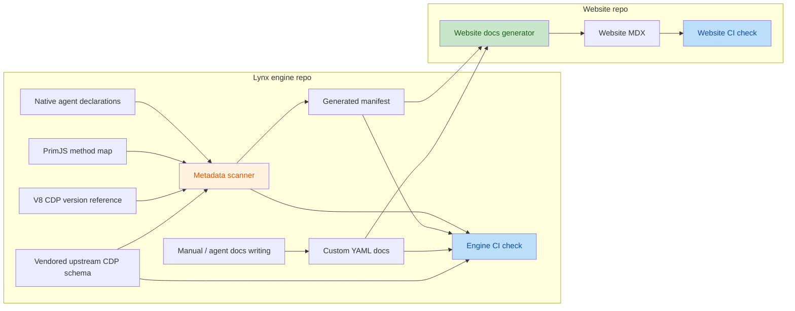

# DevTool CDP Metadata Workflow

## Workflow



## Target Files

- `devtool/lynx_devtool/protocol/cdp_manifest.generated.yaml`
  - Generated inventory of locally supported CDP methods and future CDP entries such as events.
  - Contains engine-owned external CDP references, such as the V8 CDP documentation root adopted by Lynx.
  - Rewritten by the update script.
  - Do not edit by hand.
- `devtool/lynx_devtool/protocol/custom_cdp_docs/`
  - Human-maintained docs data for Lynx-extension CDP entries.
  - Written manually or by agents; not generated by the metadata update script.
  - Contains one YAML file per documented Lynx-extension method or event.
  - Uses `Domain/methods/method.yaml` paths for methods, such as `DOM/methods/getDocumentWithBoxModel.yaml`.
  - Uses `Domain/events/event.yaml` paths for events, such as `WhiteBoard/events/onSharedDataAdded.yaml`.
  - Structured fields are the executable contract for Lynx-extension entries; see Contract Rules.
- `devtool/lynx_devtool/protocol/cdp_support.yaml`
  - Human-maintained Lynx shape differences (`deviations`) from vendored standard CDP.
  - Applied on top of the vendored schema before docs examples are validated, and exported to the generated manifest.
- `devtool/lynx_devtool/protocol/cdp_protocol.generated.h`, `cdp_protocol.generated.cc`
  - Generated C++ types with `Decode` / `Encode` for domains marked `codegen: typed`; see Typed Codegen.
  - Linked into production through `//devtool/lynx_devtool/protocol`.
  - Rewritten by the update script. Do not edit by hand.
- `devtool/lynx_devtool/protocol/cdp_contract_schema.generated.h`, `cdp_contract_schema.generated.cc`
  - Generated C++ carrying the effective runtime contract for `CDPContractChecker`.
  - Rewritten by the update script. Do not edit by hand.
- `devtool/base_devtool/native/public/cdp_codec.h`
  - Hand-written decode / encode building blocks used by the generated types.
- `devtool/lynx_devtool/protocol/cdp_contract_checker.{h,cc}`
  - Checks CDP traffic against the generated contract. Test and debug use only; see Runtime Contract Check.
- `devtool/lynx_devtool/protocol/cdp_upstream/protocol.json`
  - Vendored Chrome DevTools Protocol schema.
  - Generated by `tools/cdpc upstream write`.
  - Updated deliberately, not fetched during normal CI.
- `devtool/lynx_devtool/protocol/cdp_upstream/README.md`
  - Source, version, license, and update notes for the vendored CDP schema.
- `devtool/lynx_devtool/protocol/cdp_upstream/LICENSE`
  - License text copied from the vendored CDP schema source.
- `devtool/lynx_devtool/protocol/scripts/cdpc/`
  - The `cdpc` Python package behind `tools/cdpc`; its modules are listed under cdpc Modules.

## cdpc Commands

`tools/cdpc` (`tools\cdpc.ps1` on Windows) is the command line for CDP Contract. It runs the `cdpc` package (`python3 -m cdpc` with `scripts/` on `PYTHONPATH`) in the `tools/env.sh` environment; `tools/cdpc help` lists the commands.

```bash
tools/cdpc write
tools/cdpc check
tools/cdpc check --require-primjs
tools/cdpc list DOM --no-docs
tools/cdpc show DOM.enable
tools/cdpc stubs WhiteBoard --apply
tools/cdpc diff DOM Page
tools/cdpc test
```

- `write`
  - Scans native domain agents and the PrimJS runtime method map.
  - Validates `custom_cdp_docs/` and `cdp_support.yaml` contracts and fails without writing if they are invalid.
  - After writing, points at `tools/cdpc stubs <Domain> --apply` when a typed domain's Backend implementation does not declare every Backend method yet, or when no single class implements it. It only reads the hand-written code.
  - Legacy method declarations left in a typed domain fail the command after the generated files are written, so a migration in progress gets the new types (and editor completion) before the old code is removed. `check` fails on them as well; `list`, `show` and `diff` only warn.
  - Compares local methods with vendored standard CDP.
  - Rewrites `cdp_manifest.generated.yaml`, `cdp_protocol.generated.{h,cc}` and `cdp_contract_schema.generated.{h,cc}` only when their bytes change.
  - Formats generated C++ with `buildtools/llvm/bin/clang-format` (version 18, from `tools/hab sync .`) and fails if it is missing or a different version.
- `check`
  - Runs the same scan and contract validation.
  - Builds expected generated metadata in memory.
  - Fails if the checked-in generated YAML or C++ is stale.
  - Prints the command developers should run to update it.
- `list [Domain|Domain.glob ...]`
  - Lists implemented methods and the events that are documented or named in Lynx sources, with origin, typed codegen, scope, docs and source file. It writes no files.
  - Patterns are a domain (`DOM`) or a glob on the full name (`'DOM.get*'`). `--methods` / `--events`, `--standard` / `--lynx` and `--no-docs` narrow the list.
- `show <Domain.name>`
  - Prints one entry's effective contract: the upstream shape with deviations and docs additions applied. Each field is labeled `upstream`, `docs`, `added in docs`, or `added/retyped/omitted by deviation: <reason>`; docs fields the contract drops are listed as `ignored`.
  - Also prints where it is implemented or sent from, its docs, scope, typed codegen, lifecycle, the upstream link and the fields of referenced `$ref` types.
  - Upstream entries Lynx does not implement are shown too, so their shape can be looked up before implementing them.
- `stubs <Domain> [--apply] [--import-session FILE]`
  - Prints the Backend override declarations of a typed domain to stdout. It writes no files.
  - `--apply` adds the missing overrides to the only class under `devtool/` that derives from `protocol::<namespace>::Backend`: declarations after its last Backend override, and definitions before the closing namespaces of the `.cc` next to the header. Each new definition replies `MethodNotFound` ("`<Domain.method>` is not implemented"), so the build passes and an unfilled method fails visibly instead of getting the empty fallback success. Only the inserted lines are formatted.
  - When the domain is mid-migration, `--apply` follows that state instead: an old agent with no Backend gets an adapter and a golden harness; an adapter is rewritten as `legacy.migrated` grows; a fully migrated domain loses the adapter and the domain-level `legacy:` block. See `agents/cdp_contract.md`, "Migrating an existing domain".
  - Existing hand-written method bodies are not rewritten. Overrides of methods the Backend no longer has are reported for removal by hand. Test doubles that implement the Backend, such as a `DirectBackend` in a unittest `.cc`, are not touched.
  - `--import-session` filters a captured CDP log to this domain, scrubs user content, and writes `testdata/golden/sessions/`. The rules are the docstring of `scripts/cdpc/golden.py`.
- `check [--golden-bin EXEC]`
  - Also checks golden files, scrubbed sessions, and callers of CDP methods whose declaration this branch removed. `--golden-bin` (or `CDPC_GOLDEN_BIN`) replays `*Golden*` tests. A missing executable is exit status 3.
- `diff [Domain ...]`
  - Prints how Lynx differs from `cdp_upstream/protocol.json` for every standard domain Lynx touches, or only the given ones. It writes no files.
  - Methods: upstream methods Lynx does not implement, Lynx-extension methods, and implemented upstream methods without docs (their shape is assumed to match upstream).
  - Events: upstream events named by a string literal in non-test `devtool/` and `platform/` sources, and the ones not found. This is a heuristic; engine-forwarded domains are not scanned.
  - Fields: `added`, `omitted` and `retyped` fields of upstream entries, from deviations (with their reason) or docs additions; `ignored` lists docs fields nested inside upstream fields, which the contract drops.
  - Field differences come from the contract, not from the C++ implementation. The runtime contract checker is what catches undeclared fields the implementation actually sends.
- `--require-primjs` (for `write`, `check`, `list`, `show` and `diff`)
  - Without it, a missing PrimJS source keeps the PrimJS rows from the checked-in manifest and prints an unverified warning, so local checkouts without PrimJS still work.
  - CI should pass it so a missing PrimJS source fails instead of silently reusing rows.
- `test`
  - Runs the unit tests in `scripts/cdpc/tests/`. `tools/cdpc` is a bash wrapper around `tools/env.sh python3 -m cdpc`, not a Python script.
- `write` and `check` end with one conclusion line. Exit status 0 means no error (warnings are allowed), 1 means at least one error, 2 is usage, and 3 is a missing environment (clang-format, PrimJS with `--require-primjs`, a golden executable, or a symlink that leaves the checkout).
- `--color=auto|always|never` (any position; `--no-color` is `never`)
  - Output marks every line with a symbol, so it reads the same without color: `+` added, `-` missing or omitted, `~` retyped, `!` ignored, `?` no docs, `==` section.
  - `auto` colors only an interactive terminal that is not `TERM=dumb`, and follows `NO_COLOR` and `FORCE_COLOR`. Color only adds escape codes; stripping them gives the plain output, which `tests/style_test.py` checks.
  - In messages, CDP names and fields are cyan, file paths blue and `code` bold.
- `--width=N` (any position)
  - Lines wrap between words at 100 columns, or the terminal width when it is narrower; continuation lines align with the text they continue. Words such as paths and URLs are never split, so one longer than the line may overflow. When a table's last column does not fit, it moves below its row.
- `write` and `check` print unverified contract items, such as referenced events without a contract, without failing.

## cdpc Modules

`scripts/cdpc/` is a Python package. A module may import only modules listed before it in `cdpc.LAYERS` (`__init__.py`), and command modules never import each other; `tests/layering_test.py` enforces both.

| Layer | Module | Responsibility |
|-|-|-|
| base | `repo` | Repository paths (`Paths`, `get_paths`, `relative_path`) and `CdpcError` |
| base | `style` | Color, symbols and width-aware wrapping of terminal output |
| base | `contract` | Contract model: upstream schema, `cdp_support.yaml`, docs fields and examples, runtime schema export |
| data | `codegen` | C++ types and Backend/Agent dispatch for typed domains |
| data | `scan` | Reads hand-written sources: method tables, PrimJS map, registration scopes, Lynx version, event literals, Backend implementation classes |
| data | `manifest` | Builds `cdp_manifest.generated.yaml` and reads the checked-in one back |
| data | `schema_cpp` | `cdp_contract_schema.generated.{h,cc}` for the runtime checker |
| data | `changes` | Field-level differences between an upstream entry and its contract |
| data | `inventory` | Loads contracts and joins them with the scans; typed-domain method inventory |
| data | `golden` | Request matrix, session scrubbing, golden-file checks, and the replay unittest |
| commands | `outputs` | `write` and `check`: every generated file |
| commands | `query` | `list` and `show` |
| commands | `diff` | `diff` |
| commands | `stubs` | `stubs` and `--apply` |
| commands | `upstream` | `upstream write` and `upstream check` |
| entry | `__main__` | The only argument parser; dispatches to the commands |

Tests live in `tests/<module>_test.py`; `tests/support.py` holds shared fixtures.

## cdpc upstream Commands

```bash
tools/cdpc upstream check
tools/cdpc upstream write \
  --revision <devtools-protocol-commit>
tools/cdpc upstream write \
  --browser-protocol [BROWSER_PROTOCOL_JSON] \
  --js-protocol [JS_PROTOCOL_JSON]
```

- `upstream check`
  - Without input files, validates that `cdp_upstream/protocol.json` is in the canonical generated JSON format.
  - With `--revision` or local input files, builds expected generated schema in memory and fails if the checked-in schema differs.
- `upstream write`
  - Requires either `--revision` or both local upstream protocol files.
  - Combines upstream `json/browser_protocol.json` and `json/js_protocol.json`.
  - Rewrites `cdp_upstream/protocol.json` with deterministic two-space JSON formatting and a trailing newline.

## Website Docs Generation

Website documentation is generated in the website repository from `cdp_manifest.generated.yaml` and `custom_cdp_docs/`; the website repository owns the generator script, MDX structure, presentation, and website CI check.

## Source Scan Scope

Scan non-forwarding native domain agents:

- `devtool/lynx_devtool/agent/domain_agent/*.cc`
- Exclude `*_unittest.cc`.
- Extract entries matching `functions_map_["Domain.method"]` or direct
  `if (method == "Domain.method")` branches in an agent's `CallMethod` function.
- Store the declaration file as `source` for each extracted method.
- Domains marked `codegen: typed` are not scanned. Their methods come from their contract docs, with the docs file as `source`.
- Do not use forwarding-only JS-engine domain agents as method inventory sources.
  - `Debugger`, `Runtime`, `HeapProfiler`, and `Profiler` are registered as DevTool domains, but their domain agents forward requests through `devtool_mediator_->DispatchJSMessage(...)`.
  - `Debugger` may also contain local pre-hook methods before forwarding. Treat those entries as forwarding hooks, not as complete method support declarations.

Scan the PrimJS runtime CDP method map:

- `third_party/quickjs/src/src/inspector/protocols.cc`
- Extract method keys from `debugger_function_map` in `GetDebugFunctionMap()`.
- Store the map file as `source` for each extracted method.
- These entries represent the PrimJS inspector implementation. Use the listed source path only as implementation evidence.
- Do not add per-method runtime availability fields. Website docs can explain globally that PrimJS is used for both Main-Thread Scripting and Background-Thread Scripting.

Record the V8 external CDP reference:

- V8-backed runtime CDP is delegated to V8 Inspector and should not generate per-method entries from Lynx source.
- Store the engine-adopted V8 CDP documentation root under `externalReferences.v8.cdpRoot`.
- Current value is hardcoded as `https://chromedevtools.github.io/devtools-protocol/1-3`.
- Update this value when Lynx upgrades the adopted V8 Inspector protocol version.
- Do not scan or parse V8 source code for this workflow.

Scan domain registration:

- `devtool/lynx_devtool/lynx_devtool_ng.cc`
- Extract `RegisterAgent("Domain", ...)`.
- Use registration location to mark domain scope:
  - `global`
  - `instance`
  - `global-and-instance`

Do not infer detailed API docs from C++ implementation bodies. Use the scan only for inventory and source links.
Do not scan arbitrary string literals, unlisted engine implementation maps, or one-off protocol checks as supported CDP entries.
If a method or event is not declared in a scanner-friendly place, treat it as unsupported by this metadata flow until the implementation adds a proper declaration.

## Deferred Scope

These are intentional current boundaries rather than task records.

- Runtime-backed CDP inventory is limited to the PrimJS method map.
  - JavaScriptCore is omitted because Lynx does not support CDP in JSC.
  - V8 is represented only by `externalReferences.v8`; do not emit V8 per-method entries.
  - Do not add per-engine availability metadata. Keep method rows as `name`, `origin`, and `source`.
- Lifecycle metadata comes only from contract docs.
  - `experimental: true` and `deprecated: true` in a docs file are exported on the matching manifest entry.
  - Entries without docs never get lifecycle fields; do not infer them from prose.
- Standard events are listed only when they have a docs file. Selecting upstream event subsets is not part of this flow yet.

Future discussion reference:

- Consider a lightweight CDP declaration framework so code declares support through a uniform DSL instead of the current heuristic scanner.
- The declaration should be compile-checked but should not become a runtime registry. It can use macros around small enum values for `scope`, `engine`, and `lifecycle`.
- Example shape:

  ```cpp
  LYNX_CDP_METHOD(Runtime, evaluate, kInstance, kPrimJS, kActive)
  LYNX_CDP_METHOD(DOM, getDocument, kInstance, kEngineIndependent, kActive)
  LYNX_CDP_EVENT(Runtime, consoleAPICalled, kInstance, kPrimJS, kActive)
  ```

- `origin` should still be generated by comparing declarations with the vendored upstream CDP schema, not declared in C++.
- Native domain agents should declare their native CDP entries near their implementation; runtime-backed implementations such as PrimJS and future runtimes should declare only the entries they actually implement.
- A future migration scanner should cross-check legacy implementation maps, such as `functions_map_`, against declarations so undeclared implemented methods are detected.
- Header placement is unresolved. `devtool/lynx_devtool/protocol/cdp.h` is natural for Lynx DevTool agents, but it may be an awkward dependency for third-party runtime code. A matching runtime-local declaration header can keep PrimJS independent from Lynx while still giving the scanner deterministic method and event names.
- The declaration header must be lightweight and dependency-neutral: enum values and macros only, with no JSON, dispatcher, `CDPDomainAgentBase`, or LynxDevTool mediator dependency.

## Controlled Field Values

Generated metadata enum fields are closed sets. The generator and `tools/cdpc check` must reject values not listed in this document. Adding a new value requires updating this section and the validator in the same change.

- `origin`: `standard`, `lynx-extension`
- `scope`: `global`, `instance`, `global-and-instance`
- `deviations[].kind`: `added`, `omitted`, `retyped`

## Classification Rules

Use `Domain.method` as the stable key for methods and `Domain.event` for events.
Events use the same origin values as methods.

- `origin: standard`
  - The domain and method exist in vendored CDP.
  - Website docs should link to the official CDP method or domain.
- `origin: lynx-extension`
  - The domain or method is provided by Lynx and does not exist in vendored CDP at the same metadata location.
  - If this value is on a domain, the whole domain is a Lynx extension to CDP.
  - If this value is on a method inside a `standard` domain, the method is a Lynx extension to that standard CDP domain.
  - Website docs must be generated from `custom_cdp_docs/`.

## Generated Metadata Shape

```yaml
version: 3
generatedFrom:
  chromeDevToolsProtocol: cdp_upstream/protocol.json
upstreamRoot: https://chromedevtools.github.io/devtools-protocol/tot
externalReferences:
  v8:
    displayName: V8
    cdpRoot: https://chromedevtools.github.io/devtools-protocol/1-3
domains:
  - name: DOM
    origin: standard
    scope: instance
    methods:
      - name: getDocument
        origin: standard
        since: '4.1'
        source: devtool/lynx_devtool/agent/domain_agent/inspector_dom_agent_ng.cc
      - name: getDocumentWithBoxModel
        origin: lynx-extension
        since: '4.1'
        source: devtool/lynx_devtool/agent/domain_agent/inspector_dom_agent_ng.cc
  - name: Tracing
    origin: standard
    scope: global
    methods:
      - name: start
        origin: standard
        since: '4.1'
        source: devtool/lynx_devtool/agent/domain_agent/inspector_tracing_agent.cc
    deviations:
      - target: tracingComplete.parameters.isStartupTracing
        kind: added
        as:
          type: boolean
          optional: true
        reason: "Marks the tracingComplete event sent for a startup tracing file."
  - name: WhiteBoard
    origin: lynx-extension
    scope: instance
    methods:
      - name: setSharedData
        origin: lynx-extension
        since: '4.1'
        source: devtool/lynx_devtool/agent/domain_agent/inspector_white_board_agent.cc
    events:
      - name: onSharedDataAdded
        origin: lynx-extension
        since: '4.4'
        source: devtool/lynx_devtool/protocol/custom_cdp_docs/WhiteBoard/events/onSharedDataAdded.yaml
  - name: Recording
    origin: lynx-extension
    scope: instance
    methods:
      - name: start
        origin: lynx-extension
        since: '4.1'
        source: devtool/lynx_devtool/agent/domain_agent/inspector_recording_agent_ng.cc
  - name: Runtime
    origin: standard
    scope: instance
    methods:
      - name: evaluate
        origin: standard
        since: '4.1'
        source: third_party/quickjs/src/src/inspector/protocols.cc
      - name: getHeapUsage
        origin: standard
        since: '4.1'
        source: third_party/quickjs/src/src/inspector/protocols.cc
```

Rules:

- Do not store derived entry keys. Method keys are derived as `<domain.name>.<method.name>`.
- Do not store per-domain or per-method upstream URLs.
- Do not store `domains.sources`.
- Do not store per-method runtime availability fields.
- Do not store domain-level `since`; domains are grouping namespaces.
- `methods[].since` and `events[].since` are mandatory. A `since` declared in the entry's docs file wins; otherwise the checked-in value is kept; new entries without one get the current Lynx version.
- `methods` and `events` are omitted when a domain has none.
- `events[].source` is the contract docs file.
- `experimental` / `deprecated` appear only when `true`.
- `deviations` lists the domain's registered differences from vendored standard CDP. Each row has `target`, `kind`, `reason`, and `as` for `added` / `retyped`.
- Store `since` as a single-quoted string, such as `'4.1'`, not as a YAML number.
- Website docs own global prose for PrimJS MTS/BTS behavior and V8 delegated behavior.
- Derive standard CDP links from `upstreamRoot`:
  - Domain page: `<upstreamRoot>/<Domain>/`
  - Method: `<upstreamRoot>/<Domain>/#method-<method>`
  - Event: `<upstreamRoot>/<Domain>/#event-<event>`
- Derive V8 external reference links from `externalReferences.v8.cdpRoot` if the website needs V8-specific links:
  - Domain page: `<externalReferences.v8.cdpRoot>/<Domain>/`
  - Method: `<externalReferences.v8.cdpRoot>/<Domain>/#method-<method>`

## Manual Docs Shape

Each Lynx-extension method has one docs file:

```text
devtool/lynx_devtool/protocol/custom_cdp_docs/Memory/methods/getAllMemoryUsage.yaml
```

```yaml
summary: Gets global Lynx memory usage across live registered Lynx instances.
parameters:
  - name: timeoutMs
    type: number
    optional: true
    description: Non-negative timeout in milliseconds. `0` or omission lets the platform choose its default wait policy. Maximum accepted value is `300000`.
returns:
  - name: collectionStatus
    type: string
    enum: [completed, timeout]
    description: Whether all expected instance fetchers completed.
  - name: totalBytes
    type: number
    description: Global Lynx-attributed bytes, excluding `appBytes` and deduplicating shared background runtime groups.
  - name: appBytes
    type: number
    description: Current app memory footprint sampled by the platform.
  - name: instances
    type: array
    description: Completed instance list, sorted by `totalBytes` descending.
events: []
notes:
  - Send this method to the global DevTool handler with session ID `-1`.
  - This method differs from `Runtime.getHeapUsage`, which only reports JavaScript heap usage for one session/thread.
examples:
  - title: Use the platform default timeout
    request:
      id: 1
      method: Memory.getAllMemoryUsage
  - title: Use an explicit timeout
    request:
      id: 2
      method: Memory.getAllMemoryUsage
      params:
        timeoutMs: 50000
```

Rules:

- Every `lynx-extension` method must have a matching entry.
- `standard` methods do not need manual docs unless Lynx behavior differs from upstream.
- Manual docs are keyed by path: `custom_cdp_docs/<Domain>/methods/<method>.yaml`.
- Every Lynx-extension event is declared by `custom_cdp_docs/<Domain>/events/<event>.yaml`.
- A standard method may have a docs file only for Lynx-specific notes or behavior differences.
- The metadata check or website generator should fail if a docs file has no matching metadata method.
- The metadata check or website generator should fail if a required manual docs entry is missing.

## Contract Rules

`custom_cdp_docs/` structured fields are the contract for Lynx-extension entries. The update script validates every docs file in both modes; errors are reported as `file:line: reason`.

Top-level keys:

- Methods: `summary` (required), `parameters`, `returns`, `events`, `notes`, `examples`, `experimental`, `deprecated`, `since`.
- Events: `summary` (required), `parameters`, `notes`, `examples`, `experimental`, `deprecated`, `since`.
- Unknown keys fail.
- `since` is a hand-maintained, quoted `major.minor` string such as `'4.1'`: the Lynx version that introduced the entry. Declare it when the entry already shipped before its docs file was added; entries that existed before `since` was introduced use `'4.1'`. An unquoted `4.1` is a YAML number and fails.

Field entries in `parameters` / `returns`:

- Keys: `name`, `type` or `$ref` (exactly one), `optional`, `description`, `default`, `minimum`, `maximum`, `enum`, `items`, `typeName`, `experimental`, `deprecated`, `root`.
- `type` is `string`, `integer`, `number`, `boolean`, `object`, `array`, `null`, `any`, or a `|` union of them. `any` cannot be part of a union.
- A field without `optional: true` is required.
- `a.b` is property `b` of object `a`; declare `a` first, and its type must include `object`.
- `a[]` declares the element of array `a`; `a[].b` declares a property of an object element. `items: {type: ...}` is the same as declaring `a[]`.
- `a.<key>` declares the value of a string-keyed map `a`.
- An array without `items` or element fields only guarantees the outer array. An `object` without child fields accepts any object; `any` accepts any value.
- `enum` needs a string type. `minimum` / `maximum` need a numeric type. `default` must match the field.
- `$ref: Domain.Type` refers to a vendored CDP type.
- `typeName` reserves an UpperCamelCase name for generated code and does not change the wire format.
- `root: true` on the first entry, named `params` in `parameters` or `result` in `returns`, describes the whole value instead of a field. Use it for non-object results such as `Lynx.getVersion`. Root params that are not objects are reported because `DispatchCDPMessage` rejects them.

Standard entries:

- The vendored schema with `cdp_support.yaml` deviations applied is the contract.
- A docs file for a standard entry may add Lynx-only fields. Redeclared upstream fields must stay kind-compatible; register a deviation for real shape changes.

`cdp_support.yaml` codegen:

```yaml
WhiteBoard:
  codegen: typed
```

- `codegen: typed` on a Lynx-extension domain generates every entry in its docs, which must exist.
- `codegen: typed` on a standard domain needs `methods: [...]`, the upstream methods Lynx implements, and optionally `events: [...]`, the upstream events it sends. Only listed entries are generated, using the upstream shape with deviations and docs additions applied. The domain's Lynx-extension docs entries are generated too. A documented standard entry must be listed.
- `methods` / `events` are rejected without `codegen: typed` and on Lynx-extension domains.
- Engine-forwarded domains (`Debugger`, `Runtime`, `HeapProfiler`, `Profiler`) cannot be typed.

```yaml
DOM:
  codegen: typed
  methods: [enable, getDocument]
  events: [documentUpdated]
```

`cdp_support.yaml` deviations:

```yaml
Tracing:
  deviations:
    - target: tracingComplete.parameters.isStartupTracing
      kind: added
      as: {type: boolean, optional: true}
      reason: Marks the tracingComplete event sent for a startup tracing file.
```

- `target` is `<command-or-event>.parameters|returns.<field path>` inside an upstream domain.
- `added` needs `as` and a field that does not exist upstream. `omitted` needs an existing field and no `as`. `retyped` needs `as` and an existing field.
- `reason` is required. Remove the deviation when the implementation matches upstream.

Examples:

- Each example has `title` and one or more of `request`, `response`, `event`. A legacy `response` with `method` and no `id` is treated as an event.
- Requests must target the documented method and are validated strictly; unknown params fields fail.
- A request may violate the contract only when its response is an `InvalidParams` (`-32602`) error.
- Results are validated strictly against `returns`. Errors need integer `code` and string `message`, and an id that matches the request.
- Events must be the documented event, or be listed in the method's `events`. Their params are validated when the event has a contract; otherwise the example is reported as unverified.

## Typed Codegen

Domains marked `codegen: typed` get C++ types in `lynx::devtool::protocol::<domain_snake_case>`:

- `<Method>Params` and `<Method>Result` for methods with fields, and one struct per event named after the event.
- `bool Decode(const Json::Value& params, <Method>Params*, std::string* error)`. Declared fields are checked for presence and type; unknown fields are ignored. On failure `error` names the field, such as `params.value: has an unexpected type` or `params.value: missing required field`. A value that is not an object fails as `params: expected object`. The handler replies `InvalidParams` with that text unless `legacy.errors` replaces it.
- `Json::Value Encode(const <Method>Result&)` returns the result object for `CDPResponder::SendSuccess`.
- `Json::Value Encode(const <Event>&)` returns the complete event message.

Type mapping: `string` -> `std::string`, `integer` -> `int64_t`, `number` -> `double`, `boolean` -> `bool`, objects with fields -> nested structs named `<Parent><Field>` (`<Parent><Field>Item` for array elements, override with `typeName`), `a.<key>` -> `std::map<std::string, T>`, arrays -> `std::vector<T>`, optional fields -> `std::optional<T>`. `any`, unions, and objects without fields are `Json::Value`. An object without fields is still type-checked: Decode accepts only a JSON object, and rejects an array, string, number, boolean, or null with `has an unexpected type` (or `expected object` when the params value itself is not an object). String enums and union kinds are checked on decode, including inside arrays and maps (`cdp::CheckEach`).

`$ref` types:

- A referenced vendored type is generated once, in the namespace of its domain, for example `protocol::dom::Node`. Only types reachable from typed entries are generated.
- Objects with properties become structs. Primitive, array and property-less object types become aliases, such as `using NodeId = int64_t;`. String enums also get constants, such as `dom::PseudoTypeEnum::kFirstLine`.
- A struct can hold only complete types by value. Value members (direct, optional or map) that form a cycle are held through `cdp::Box<T>`; `std::vector<T>` members stay unboxed. `cdp::Box` copies deeply and allocates lazily, so a default or moved-from box reads as a default `T`.
- Structs are emitted with value dependencies first.

Not supported yet: `root: true`. The update script fails on it.

Method inventory: typed domains are not scanned. Their methods are the generated entries; `source` is the docs file, or `cdp_support.yaml` for an undocumented standard method. Legacy `functions_map_` or `if (method == ...)` declarations left in a typed domain fail the update script, so a standard domain moves to typed in one step. While `legacy.agent` names the old file and `legacy.migrated` does not yet list every method, leftovers in that file are warnings.

`validation` is `strict` (the default, WhiteBoard) or `legacy`. Under `legacy`, a method omitted from `legacy.migrated` is forwarded as `cdp::RawCall` with no Decode. A method with `legacy.validate: handler` takes `cdp::Deferred<Params>` so Decode runs when the Backend calls `Get()`, after its thread hop. `legacy.errors` replaces the codec message for one field and reason. `legacy.order`, when present, is the dispatch order; otherwise methods stay alphabetical. `golden.file` is a JSONL of replay cases. `golden.volatile` names fields replaced after a type check (`monotonic`). `golden.allowedDiffs` entries need `case`, `path`, `from`, `to`, and `reason`.

The codegen fixture under `testdata/fixture/` has its own vendored schema, support file and docs, and covers every shape above. `tools/cdpc write` regenerates `testdata/fixture/fixture_protocol.generated.{h,cc}` into the `protocol_fixture` namespace and `tools/cdpc check` verifies it; `cdp_protocol_fixture_unittest.cc` compiles and exercises it. Extend the fixture when adding a codegen feature.

Dispatch layer, also generated for each typed domain:

- `<Method>Responder` is `cdp::Responder<<Method>Result>`, or `cdp::Responder<cdp::Empty>` without result fields. It is a thin typed view of the `CDPResponder` (`cdp_typed_responder.h`): `SendSuccess` takes the generated result type and encodes it; completion, the fallback response and threading stay with `CDPResponder`.
- `Backend` has one pure virtual function per method, taking the responder and the decoded params. A missing or mismatching override fails to compile.
- `Agent` implements the responder-based `CallMethod`: it runs `PreDispatch`, decodes params (replying `InvalidParams` on failure), and calls the Backend. Unknown methods get `MethodNotFound`.
- `PreDispatch(method, message, responder)` runs before decoding and allows every request by default. Subclass `Agent` and return `false` after replying to reject a request.
- `CreateAgent(std::unique_ptr<Backend>)` wraps a Backend for `RegisterAgent`, and returns nullptr for a null Backend.

Adding a command to a typed domain:

1. Add `custom_cdp_docs/<Domain>/methods/<method>.yaml`.
2. Run `tools/cdpc write`.
3. Run `tools/cdpc stubs <Domain> --apply` to add the override and a `MethodNotFound` stub to the Backend implementation.
4. Replace the stub body with the implementation. Typed domains take their method inventory from the contract, so do not add `functions_map_` entries; the update script rejects legacy declarations in a typed domain.

Descriptions and examples do not reach C++, so docs-only edits keep the generated bytes unchanged.

## Runtime Contract Check

`cdp_contract_schema.generated.cc` embeds the effective contract: every supported method, every documented event, the upstream events of supported domains, and the referenced upstream types, with deviations applied. Docs-only constraints (`default`, `minimum`, `maximum`) are not included.

`CDPContractChecker` (`//devtool/lynx_devtool/protocol:cdp_contract_checker`) validates traffic against it:

- Requests are checked leniently; unknown params fields are allowed.
- Success results and event params are checked strictly; undeclared fields are reported.
- Error responses must have an integer `code` and a string `message`.
- Responses are matched to requests by channel and id. A response without an outstanding request, such as a second response to one request, is reported.
- Events without a contract are reported as undeclared.

The checker only observes. Use it in two ways:

- Unit tests feed requests and the captured responses or events to `OnIncomingMessage` / `OnOutgoingMessage`. See `WhiteBoardInspectorDelegateTest.ResponsesAndEventsMatchContract`.
- Debug runs install it with `SetCDPTrafficObserver(CDPContractChecker::CreateWithGeneratedContract(nullptr))`. `ViewMessageChannel` and `GlobalMessageChannel` then report all CDP traffic to it, and violations are logged with `LOGE`. Messages sent through SDK-side CDP listeners do not pass these channels.

The target links about 130 KB of contract data. Do not depend on it from production targets.

## CI Check

Pre-submit should run:

```bash
tools/cdpc upstream check
tools/cdpc check --require-primjs
```

Expected CI behavior:

- Fail if `cdp_upstream/protocol.json` is not in generated canonical JSON format.
- Fail if code scan output differs from `cdp_manifest.generated.yaml`.
- Fail if generated metadata contains Lynx-extension methods missing from `custom_cdp_docs/`.
- Fail if a docs file or `cdp_support.yaml` violates the Contract Rules.
- Fail if the PrimJS method map is missing when `--require-primjs` is passed.
- Do not fetch network resources.
- Do not modify files.
- Print the local update command.

Failure message format:

```text
DevTool CDP metadata is stale.
Run:
  tools/cdpc write
Then review and commit:
  devtool/lynx_devtool/protocol/cdp_manifest.generated.yaml
  devtool/lynx_devtool/protocol/custom_cdp_docs/
  devtool/lynx_devtool/protocol/cdp_support.yaml
```

## Developer Update Flow

1. Change DevTool CDP implementation code.
2. Run:

   ```bash
   tools/cdpc write
   ```

3. Review generated diff in `cdp_manifest.generated.yaml`.
4. If new Lynx-extension methods or events were added, update `custom_cdp_docs/`. If a standard entry's wire shape differs from upstream, add a deviation to `cdp_support.yaml`.
5. Run:

   ```bash
   tools/cdpc check
   ```

6. If updating website docs, follow the website repository CDP docs generator workflow against `devtool/lynx_devtool/protocol/`.

## Vendored CDP Update Flow

1. Pick the desired Chrome DevTools Protocol commit.
2. Regenerate the vendored schema:

   ```bash
   tools/cdpc upstream write \
     --revision <devtools-protocol-commit>
   ```

   If network fetch is not available, download upstream `json/browser_protocol.json` and `json/js_protocol.json` by other means, then run:

   ```bash
   tools/cdpc upstream write \
     --browser-protocol [BROWSER_PROTOCOL_JSON] \
     --js-protocol [JS_PROTOCOL_JSON]
   ```

3. Update `devtool/lynx_devtool/protocol/cdp_upstream/README.md` with the upstream commit metadata.
4. Run:

   ```bash
   tools/cdpc upstream check
   tools/cdpc write
   tools/cdpc check
   ```

5. Review methods whose origin changed.
6. Update docs data if a method moves between standard and custom classifications.

## V8 CDP Reference Update Flow

The V8 CDP reference is engine-owned metadata because it reflects the V8 Inspector protocol version adopted by Lynx. The website repository should consume it, not own it.

1. When Lynx upgrades the adopted V8 Inspector protocol version, update the hardcoded `externalReferences.v8.cdpRoot` value used by the metadata update script.
2. Current value:

   ```yaml
   externalReferences:
     v8:
       displayName: V8
       cdpRoot: https://chromedevtools.github.io/devtools-protocol/1-3
   ```

3. Regenerate and check generated metadata:

   ```bash
   tools/cdpc write
   tools/cdpc check
   ```

## Availability Notes

Generated metadata reflects method implementation in source code. It does not model compile-time configuration, runtime configuration, session state, parameter validation, or method-specific error behavior.

When conditional availability, deprecation, or behavior differences matter to users, document them in the matching file under `custom_cdp_docs/`.

Known examples:

- `Recording.start`, `Recording.end`
  - Note in manual docs that recorder support must be enabled in the current runtime.
- `Replay.start`, `Replay.end`
  - Note in manual docs that replay support must be enabled in the current runtime.
- `Log.enable`, `Log.disable`, `Log.clear`
  - Note in manual docs that messages with `sessionId` return not implemented.
- `Template.templateConfigInfo`
  - Note in manual docs that this is a compatibility stub returning an empty result because config info was removed.
